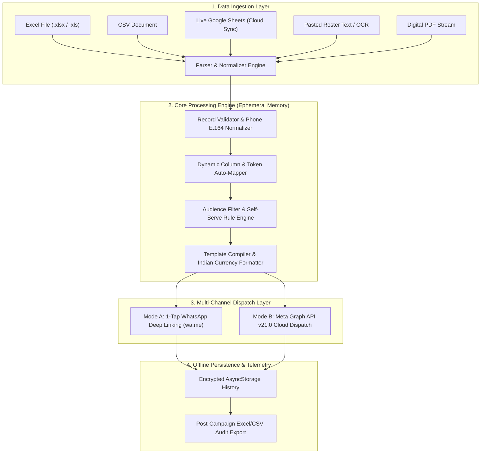

# 🚀 Dispatch — Personalized Bulk WhatsApp Automation Engine

<div align="center">


**Transform raw spreadsheets into personalized, 1-tap WhatsApp messages with zero ban risk and zero cloud data leakage.**

[](https://reactnative.dev/)
[](https://expo.dev/)
[](https://www.typescriptlang.org/)
[-10B981?style=for-the-badge&logo=jest&logoColor=white)](https://jestjs.io/)
[-6366F1?style=for-the-badge&logo=expo&logoColor=white)](https://expo.dev/accounts/saketh3773/projects/dispatch)
[](https://expo.dev/)

[📥 Download Latest Android APK](https://expo.dev/artifacts/eas/ZMYV1bXPcouSwRPR97MMm_IZiFi6MjiJtYJzUBLmnk8.apk) • [📖 Architecture](#-architecture--data-flow) • [⚡ Quick Start](#-quick-start) • [🛡️ Security Model](#-security--privacy-architecture) • [🚀 EAS & OTA Updates](#-eas-build--over-the-air-ota-updates)

</div>

---

## 📖 Overview

**Dispatch** is an enterprise-grade mobile application designed for businesses, schools, clinics, fitness centers, agencies, and service providers. It bridges the gap between raw data files (`.xlsx`, `.xls`, `.csv`, and Google Sheets) and high-touch customer communication on WhatsApp.

Traditional bulk WhatsApp tools rely on unofficial web scraping bots or reverse-engineered protocols that routinely lead to permanent account bans and compromise client privacy by uploading customer phone numbers to third-party servers.

**Dispatch takes a radically different approach:**
1. **100% Client-Side Ephemeral Processing**: All spreadsheet parsing, token compilation, and filtering occur in volatile local memory on the user's mobile device. No customer rosters ever touch an external cloud database.
2. **100% Ban-Safe Dispatch**: Utilizes official WhatsApp deep linking (`wa.me`) for individual 1-tap dispatch, with optional enterprise integration via official Meta Graph API v21.0.
3. **Dynamic Self-Serve Audience Filters**: Eliminates hardcoded schemas. Users can target audiences by creating custom conditional filter rules on any column (`equals`, `contains`, `greater than`, `less than`, `not empty`).
4. **Culturally Authentic Multi-Lingual Presets**: Out-of-the-box message templates across 8 Indian regional languages with automated Indian currency formatting (`₹12,500`).

---

## 🏗️ Architecture & Data Flow



---

## ✨ Key Capabilities

### 1. Universal Spreadsheet & Live Cloud Sync
* **Excel (.xlsx, .xls) & CSV**: Native binary parsing powered by SheetJS, handling multiple worksheets, merged headers, and arbitrary schemas.
* **Google Sheets Real-Time Sync**: Connects directly to public view links to fetch live sheet data over HTTPS without manual exports.
* **Fuzzy Token Matching**: Auto-maps spreadsheet column names to template variables (e.g. `{{Name}}`, `{{Due Date}}`, `{{Outstanding Balance}}`).

### 2. Dynamic Self-Serve Filter Builder
* Add unlimited custom rules on any detected column.
* Filter operators:
  * `Equals (=)`
  * `Contains`
  * `Greater than (>)` (Supports numeric amounts and currency strings)
  * `Less than (<)`
  * `Not Empty`
* Dismissible interactive filter pills with dynamic count recalculation.

### 3. Dual Dispatch Architecture
* **Personal 1-Tap Deep Link Mode**:
  * Opens each contact directly in WhatsApp using official universal links: `wa.me/91<phone>?text=<encoded_message>`.
  * Preserves 1-click personal engagement without contact book clutter.
* **Meta WhatsApp Business API Mode**:
  * Direct connectivity to Meta Graph API v21.0.
  * Encrypted local storage for System Access Token, Phone Number ID, and WhatsApp Business Account ID.

### 4. 8 Indian Regional Language Presets
Authentic, professional business templates available in:
* **English** 🇬🇧
* **Hindi (हिंदी)** 🇮🇳
* **Marathi (मराठी)** 🇮🇳
* **Telugu (తెలుగు)** 🇮🇳
* **Tamil (தமிழ்)** 🇮🇳
* **Kannada (ಕನ್ನಡ)** 🇮🇳
* **Bengali (বাংলা)** 🇮🇳
* **Gujarati (ગુજરાતી)** 🇮🇳

### 5. 60 FPS Animated Gradient Opening Splash
* Native-driven fluid opening screen:
  * Spring-scale Dispatch logo entrance
  * Double expanding sonic gradient wave rings (Emerald `#10B981` & Indigo `#6366F1`)
  * Pulsing radial glow halo behind the brand icon
  * Built using pure React Native Animated API for 60 FPS performance.

### 6. Over-The-Air (OTA) Live Updates
* Wired to Expo Application Services (EAS) Update.
* UI improvements, animations, and bug fixes can be delivered directly to user devices over the air without reinstalling the APK.
* Includes an in-app **Live Cloud Updates Center** under Settings to check and apply updates on demand.

---

## 📂 Project Directory Structure

```text
Dispatch/
├── assets/                          # Brand marks, app icons, and adaptive icons
│   ├── icon.png                     # Official Dispatch primary icon
│   ├── splash-icon.png              # Launch splash mark
│   ├── android-icon-foreground.png  # Adaptive icon foreground
│   └── android-icon-background.png  # Adaptive icon background
├── src/
│   ├── app/                         # Expo Router screens (File-based navigation)
│   │   ├── _layout.tsx              # Root layout & animated splash orchestrator
│   │   ├── (tabs)/                  # Bottom tab navigation
│   │   │   ├── index.tsx            # Campaign studio & home hero screen
│   │   │   ├── campaigns.tsx        # Campaign history & dispatch records
│   │   │   ├── templates.tsx        # Template library & custom template CRUD
│   │   │   └── settings.tsx         # Settings, OTA updates card, and developer portfolio
│   │   └── workflow/                # Multi-step campaign wizard
│   │       ├── import.tsx           # File dropzone, data inspector & filter builder
│   │       ├── select-method.tsx    # Dispatch channel selection
│   │       ├── send-personal.tsx    # 1-Tap WhatsApp queue worker & stepper
│   │       └── send-api.tsx         # Meta Graph API batch dispatcher
│   ├── components/                  # Reusable atomic UI components
│   │   ├── AnimatedSplashScreen.tsx # 60 FPS native gradient opening sequence
│   │   ├── Header.tsx               # Top bar with official Dispatch logo
│   │   ├── Button.tsx               # Primary / Secondary buttons with loading states
│   │   ├── Card.tsx                 # Elevated surface card container
│   │   └── ScreenContainer.tsx      # Safe-area and theme wrapper
│   ├── core/                        # Business logic engines
│   │   ├── campaign/                # Campaign storage & historical ledger
│   │   ├── filters/                 # recipientFilter.ts (dynamic rule engine)
│   │   ├── mapper/                  # Column mapping & fuzzy token matcher
│   │   ├── parser/                  # Spreadsheet & text parsers
│   │   ├── state/                   # DatasetStore.tsx (ephemeral state container)
│   │   ├── template/                # Template compiler & regional templates
│   │   ├── validator/               # Phone number & data validator
│   │   └── whatsapp/                # Meta Cloud API & wa.me deep link generators
│   ├── tokens/                      # Design system (colors, typography, spacing, themes)
│   ├── types/                       # TypeScript interfaces and domain models
│   └── __tests__/                   # 8 comprehensive Jest test suites (70 tests)
├── app.json                         # Expo configuration (SDK 58, compileSdk 37)
├── eas.json                         # EAS build profiles (preview APK & production AAB)
├── package.json                     # Dependency manifests & scripts
└── tsconfig.json                    # TypeScript compiler options
```

---

## ⚡ Quick Start

### Prerequisites
* [Node.js](https://nodejs.org/) (v20.x or v22.x LTS recommended)
* [Git](https://git-scm.com/) installed
* [Expo Go](https://expo.dev/go) on your physical mobile device, or Android Studio / Xcode emulator

### 1. Clone & Install
```bash
git clone https://github.com/SakethGoljana/Dispatch.git
cd dispatch
npm install
```

### 2. Start Local Development Server
```bash
npx expo start -c
```
* Press `a` to run on an attached Android device / emulator.
* Press `w` to run in a web browser.
* Scan the displayed QR code with Expo Go on Android or the Camera app on iOS.

### 3. Run Quality & Test Suite
```bash
# Typecheck with TypeScript (0 errors)
npx tsc --noEmit

# Run Jest unit and workflow tests
npm test
```

---

## 🛡️ Security & Privacy Architecture

* **Zero Cloud Data Retention**: Customer phone numbers and balances are processed in volatile mobile memory and cleared upon campaign completion.
* **Encrypted Local Storage**: Campaign history logs and Meta API credentials use `AsyncStorage` scoped strictly to the app sandbox.
* **Safe Deep Linking**: URLs are sanitized using `encodeURIComponent` to prevent XSS or malformed character exploits in WhatsApp chat windows.
* **No Bot Scraping**: Avoids headless browser emulation or unofficial WhatsApp protocols that trigger anti-automation bans.

---

## 🚀 EAS Build & Over-The-Air (OTA) Updates

Dispatch is pre-configured with Expo Application Services (EAS) for cloud building and over-the-air updates.

### 1. Build Android Standalone APK
To compile an installable `.apk` directly in the cloud:
```bash
npx eas-cli@latest build -p android --profile preview
```
* Builds against Android `compileSdkVersion: 37` and `targetSdkVersion: 35`.
* Generates a direct `.apk` download link and QR code.

### 2. Publish Over-The-Air (OTA) Updates
To push instant JavaScript & asset updates directly to user devices without rebuilding the APK:
```bash
npx eas-cli@latest update --channel preview --environment preview --message "Your update description"
```

---

## 📥 Latest Release & Standalone APK

| Asset | Details | Link |
| :--- | :--- | :--- |
| **Dispatch Android APK (v1.0.0)** | Version Code `6`, SDK `58.0.0`, Standalone Installable | [Download APK (EAS Artifact)](https://expo.dev/artifacts/eas/ZMYV1bXPcouSwRPR97MMm_IZiFi6MjiJtYJzUBLmnk8.apk) |
| **GitHub Release** | Tag `v1.0.0` | [GitHub Releases Latest](https://github.com/SakethGoljana/Dispatch/releases/latest) |
| **Direct APK Download** | Permanent Binary Asset | [Download dispatch-v1.0.0.apk](https://github.com/SakethGoljana/Dispatch/releases/latest/download/dispatch-v1.0.0.apk) |

---

## 👨‍💻 Creator & Maintainer

**Saketh Goljana**  
Full-Stack Mobile Engineer & Product Designer  
* 🌐 **Portfolio**: [sakethgoljana.tech](https://sakethgoljana.tech)  
* 💼 **LinkedIn**: [linkedin.com/in/saketh-goljana](https://www.linkedin.com/in/saketh-goljana/)  
* 🐙 **GitHub**: [@SakethGoljana](https://github.com/SakethGoljana)  
* 📧 **Email**: [hello@sakethgoljana.tech](mailto:hello@sakethgoljana.tech)

---

## 📄 License
This project is licensed under the [MIT License](LICENSE).
